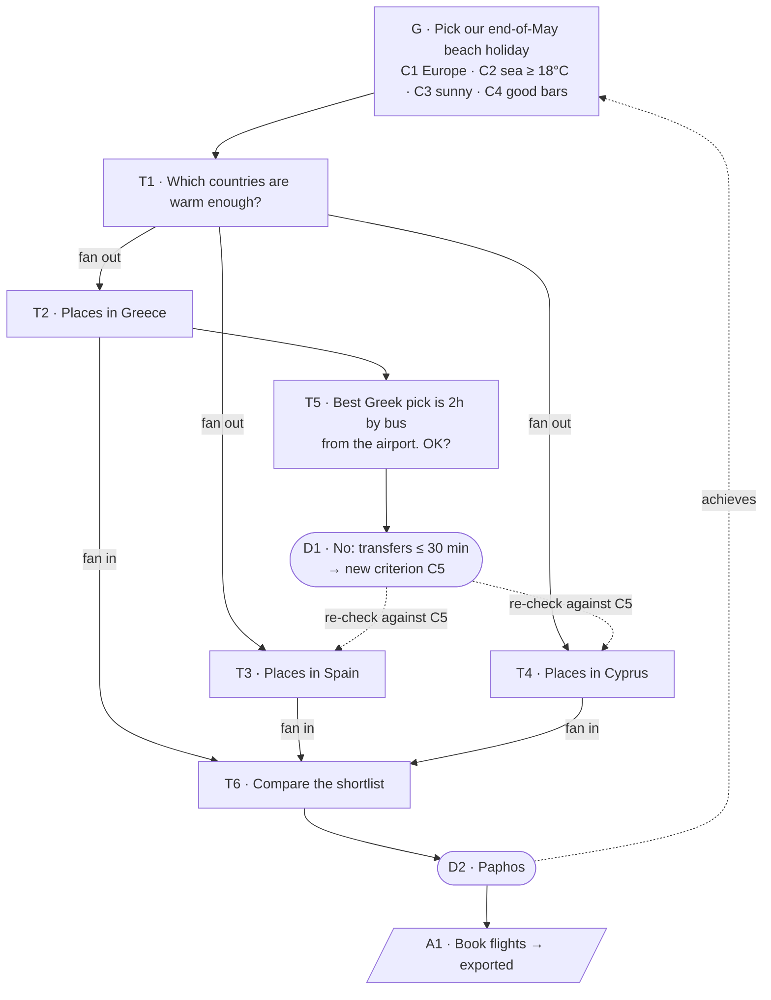

# zeigarnik

A Claude Code plugin that gives a chat session structure and drives it to a
conclusion.

You start a session with a **goal**. As you and Claude work, everything that
needs closing (questions to decide, explorations, things to do) is tracked as
numbered items in a pane beside the chat. Claude keeps the structure honest. It
opens new threads, notices when one answer settles several of them, carries
new findings to the threads they affect, and asks whether the goal is met. When
it is, you **close** the session: decisions, actions and important findings go
into whatever tracking you use (beads, Jira, Linear, files on disk, you decide…), and you get
a short **handoff** to paste into a fresh session with one focused goal.

The point is to finish things and keep the sessions and context small. 
Instead of one ever-growing conversation, you get a chain of short sessions. 
Each one has a goal and a record of what was decided and why. 
The context that matters is kept in your own system, not lost
in a transcript, and each session ends with a clean start for the next.

## Why

In a long session you are often juggling five conversations in one message.
It's easy to lose one, hard to remember the details after lunch, and the
default is to keep chatting in an ever-growing context. `zeigarnik` makes the
open loops visible, keeps the reasoning behind each decision, and makes "we're
done here" an explicit, checkable step.

## The name

It's named after the [Zeigarnik effect](https://en.wikipedia.org/wiki/Zeigarnik_effect),
which says, roughly, that the things you've started but not finished keep
putting pressure on your mind. That's what this is about: dealing with all
those open things, so they get closed and stop nagging. I don't claim it does
anything clever with the effect, I just liked the name.

The [Ovsiankina effect](https://en.wikipedia.org/wiki/Ovsiankina_effect), the
urge to get back to something that got interrupted, is probably a more
accurate fit. But Zeigarnik is easier to spell and work with :P

`zg` for short: `/zg:open`, `/zg:close`, and bead IDs like `zg-a1b`.

## What a session looks like

A goal fans out into explorations, which fan back in to a decision. Along the
way things come up that change the picture, and they need capturing where they
matter.

Here, the goal is to choose a family holiday. The family's criteria are the
starting point. One exploration turns up a long airport transfer, which
becomes a new criterion and changes how the other candidates are judged.



**Fan-out**: one thread spawns several explorations. **Fan-in**: their
results converge back into the thread that spawned them. Claude doesn't keep
track of this on its own; keeping fan-in reliable is most of what this plugin
adds.

<details open>
<summary><b>Walkthrough: planning the holiday, step by step</b></summary>

**Open.**

```
> /zg:open Pick our end-of-May beach holiday. Family wants: Europe, sea at
  least 18°C, sunny, good bars nearby.
```

Claude records the goal and its criteria, and the pane opens beside the chat:

```
┌ zg ───────────────────────────────────┐
│ G  Pick our end-of-May beach holiday  │
│    threads 0 open · 0 closed          │
│    C1 Europe  C2 sea≥18°C  C3 sunny   │
│    C4 good bars                       │
└───────────────────────────────────────┘
```

**Fan out.** Claude narrows the countries down (web search etc.) and opens a thread for each:

```
→ T1 resolved: sea ≥ 18°C by late May → Greece, Spain (south), Cyprus
→ new T2 Places in Greece
→ new T3 Places in Spain
→ new T4 Places in Cyprus
```

**Something comes up.** In T2 the best beach is a village 2h by bus from the
airport. Claude doesn't bury that in prose; it opens a question:

```
→ new T5 Q: Best Greek pick is 2h by bus from the airport. OK?
```

You answer in the main chat, addressing items by ID:

```
> T5: no, two hours with the kids is a no. Keep transfers under 30 min.
> T3: skip anything that's not on the coast road
```

**Propagate.** Claude records D1 (transfers ≤ 30 min, because of the kids)
and adds criterion C5. It then re-checks against C5: the Greek village is out,
and two Spanish options fail C5. It proposes updating T2 and T3 in one batch.
You confirm once.

```
┌ zg ───────────────────────────────────┐
│ G  Pick our end-of-May beach holiday  │
│    threads 4 open · 2 closed          │
│    C1 Europe  C2 sea≥18°C  C3 sunny   │
│    C4 good bars  C5 transfer≤30m ✱    │
│                                       │
│ ○ T2 Places in Greece                 │
│ ○ T3 Places in Spain                  │
│ ○ T4 Places in Cyprus                 │
│ ✦ T6 Compare the shortlist            │
│ ✓ T1 Countries → GR, ES, CY           │
│ ✓ T5 2h bus? → D1 no, ≤30 min         │
│                                       │
│ Actions                               │
│ ☐ A1 Check school dates (you)         │
└───────────────────────────────────────┘
○ open  ✦ new  ✓ resolved  ✗ cancelled  ✱ changed
```

**Fan in.** T2, T3 and T4 each resolve with a shortlist entry. Claude notes
that T6 now has everything it needs and lays out the question overview (as in
[Thread](#thread)). You pick Paphos: D2. T6 resolves, and Claude asks whether
G is achieved.

**Return.** Had you gone for lunch before picking, coming back to T6 would
start with a recap: "T6, compare the shortlist: three options; the criteria
changed since T2 (C5 added); the Greek village fails C5. Pending: your pick."

**Close.**

```
> /zg:close
```

Claude confirms that G is achieved and lists anything still open for you to
resolve or cancel. Then it captures what needs to outlive the session:

```
Capture (sink: reminders)
  A1 Check school dates    done
  A2 Book flights          → exported  reminders://x-9f2
  D2 Paphos (+ C1–C5)      → exported  notes/holiday-2027.md
```

Then it prints the handoff:

```
Goal: Choose where to stay in Paphos
Decisions to respect:
  - D2 Paphos; criteria C1–C5 (notes/holiday-2027.md)
References: notes/holiday-2027.md
```

Copy, `/clear`, paste, and the next session starts focused.

</details>

## The session loop

```
  open ──▶ iterate ──▶ close ──▶ handoff ──▶ (next session)
   │         │           │         │
  goal     threads     capture   next goal
           decisions   into your + the few
           actions     tracking  references
                                 it needs
```

1. **Open**: state the goal (`/zg:open`), or let Claude propose one from your
   first message and confirm it.
2. **Iterate**: each exchange moves several threads toward closing: deciding,
   clarifying, exploring. Claude tracks them; you steer.
3. **Close**: `/zg:close`. Confirm the goal's outcome, close every open item, and
   capture actions, decisions and findings in your tracking system.
4. **Handoff**: the smallest message that starts the next session well.
   `/zg:copy-handoff` copies it; `/clear`, paste. The session counts as closed
   once it is cleared after its handoff; quitting part-way leaves it open to
   resume.

## Concepts

The walkthrough above shows these concepts in use; this section defines them
precisely.

Each kind of item has a letter and its own numbering: `G`, `T1`, `D1`, `A1`,
`C1`. You refer to items by that ID in chat (`T4: …`), and the letter tells you
at a glance what kind of thing it is.

| Letter | Concept |
|---|---|
| `G` | Goal |
| `T` | Thread |
| `D` | Decision |
| `A` | Action |
| `C` | Criterion |

### Session

One Claude Code conversation from `/zg:open` to `/zg:close`. Everything below
lives inside a session. Only the handoff and what was captured into your
tracking carry over to the next one.

### Goal

What the session set out to do. It is the root thread: every thread opened to
reach it descends from it, so each goal has its own tree.

- States: `open` → `achieved` | `failed` | `cancelled`
  - `failed`: we tried and it can't be done as stated (no place meets all the
    criteria). The handoff says why and what to try instead.
  - `cancelled`: we decided it isn't worth finishing, the same meaning as for
    threads and actions.
- A failed or cancelled goal is a legitimate close. It records why, when a
  reason is given, in your own words; a pick with no note records only which
  option. It still produces a handoff. After such an end its next goal can be
  a conversation about what to do instead.
- Has an optional **origin**: the external item it works on, such as a bead or
  ticket. A goal started from a handoff takes its origin from the handoff's
  references. When there is an origin, the session keeps it in step:
  - **at open**: the origin is marked in progress, and the Claude session is
    renamed to include its ID, so the session is easy to find later
  - **at close**: the origin is updated with the result: closed if the goal
    was achieved, otherwise updated with what happened and why
  - **at capture**: new items created in your tracking link back to the
    origin ("discovered from zg-a1b"), where the tracker supports links
- **One open goal at a time.** That is the target that keeps a session on
  track, but goals change as you learn:
  - **Revised**: the goal is reworded as understanding improves. Like
    criteria, revisions are kept, with the thread that caused them.
  - **Replaced**: a different goal turns out to matter more. The current one
    closes (usually `cancelled`, with a reason), and the new one becomes `G2`.
  - **Next**: a second goal turns up. Usually it becomes the next session's
    goal. Sometimes the context at hand makes it worth doing now: close `G1`,
    and open `G2` in the same session. Claude points out what that costs in
    context before you choose.
- There is no waiting state for goals. A goal for later is recorded as a
  **decision** ("next goal: …") on the thread where it came up. The pane lists
  these under the current goal, so you can see there is more to come, and the
  handoff picks them up. If one becomes `G2` in this session, `G1`'s tree
  closes with it and `G2` starts a tree of its own.

### Thread

An ongoing conversation that we are looking to close. It might be a yes/no
question, a long exploration, or a sub-topic of one.

- Has exactly one **parent** (the goal, or another thread).
- Has a **history**: what you and Claude said about it, word for word, so you
  can reread later how it was settled. Claude's side is the part of each reply
  that addresses the thread.
- Closes with an **outcome**: a short summary of what was learned or settled,
  which rolls up into the parent.
- States:
  - `open`: not yet closed
  - `resolved`: closed with an outcome
  - `cancelled`: closed as not worth pursuing, with the reason recorded if
    one was given
- Every thread must end `resolved` or `cancelled`. To pursue something outside
  this session, close the thread with a decision to do so. That produces an
  action captured into your tracking, or it becomes the next session's goal.

**Questions** are threads whose purpose is a decision. That is how most
decisions start: Claude, or you, poses a question with options.

- **Options**: the candidate answers, referred to as `T3.1`, `T3.2` and so on.
  Each one collects the thinking about it as it happens: pros, cons, findings,
  open doubts.
- **Criteria** (see below) say what the choice is judged on.
- A question resolves into a **decision**.

The overview of a question reads like this:

```
T6 Question: Which place do we book?
   Decision: D2, T6.3 Paphos
     because: the only option meeting all of C1 to C5;
              the 20 min transfer settles C5 comfortably
   Criteria: C1 Europe · C2 sea ≥ 18°C · C3 sunny · C4 good bars
             C5 transfer ≤ 30 min (added from T5)
   Options:
     1. Greek village
        + best beach of the lot
        - 2h bus from the airport (fails C5)
     2. Costa del Sol
        + bars, easy flights
        - sea borderline for C2 in late May
     3. Paphos ✓
        + warmest sea, short transfer
        - fewer bars than option 2
```

### Criterion

What matters to us when deciding, and why. Criteria can be set upfront, or
found and revised while exploring the options. That is a normal part of
exploring, not a failure.

- Attached to a thread (often the goal) and apply to all of its descendants.
- Revisions are kept, not overwritten, with the thread that caused them.
- Changing a criterion means re-checking decisions already made under the old
  version (see [How Claude behaves](#how-claude-behaves)).

### Decision

A recorded choice: what was decided, why (citing criteria where there are
any), and what it replaces. It keeps your words of agreement as you said
them, hedges included ("fine for now, we can change it later").

- Usually the answer to a question. It can also stand alone, as a realization
  along the way ("transfers must be short").
- States: `decided` | `superseded` (a later decision replaced it) |
  `reopened`.
- Belongs to the thread where it was made.
- Scope: `session` (it only guides the rest of this session's work) or
  `lasting` (later work must respect it). You choose with Claude at close:
  lasting decisions are captured into your tracking, session ones go only in
  the handoff.

### Action

Something that must happen for the work to count as finished. It belongs to
the thread it came up in and has an owner (you or Claude).

- States: `open` → `done` | `cancelled` | `exported`. An exported action records
  its external reference (a bead ID, ticket key, file path).
- Captured as they come up, not at the end.
- Called *action* (as in meeting-minutes action items), not *todo*, so they are
  not confused with Claude's own todo list for its work steps.

### Outcome

The short summary a thread closes with. Outcomes are what you read when coming
back to a thread or reviewing a session, so you never need to reread the
history unless you want to.

### Handoff

What the next session needs to start well, and nothing more. The new session's
context should begin small and focused.

- the **next goal**, singular
- the **decisions** from this session that it must respect
- **references**: the few files, tickets or docs it should read, or the
  questions it should ask to rebuild what it needs. Only what the next goal
  needs, not everything this session touched.

IDs are local to a session: the next session starts again at `T1` and `D1`.
Anything that needs referring to later is captured into your tracking, where
it gets a lasting ID, and the session records that ID against the item
("D2 → notes/holiday-2027.md"). The handoff uses the lasting IDs, never the
session-local ones.

## Rules

These always hold. The plugin enforces them, and they are the backbone of the
tests. Anything that would break one is refused, with the reason and how to
fix it.

- **One parent.** Every item except a goal has exactly one parent. Parents
  form a tree rooted at a goal.
- **Children close first.** A thread can only be `resolved` once all of its
  children are `resolved` or `cancelled`.
- **Closing says how.** `resolved` requires an outcome. `cancelled` keeps its
  reason, if one was given.
- **Decisions belong to a thread.** A decision on a question resolves it.
- **Criteria flow down.** Criteria apply to the thread they are attached to
  and all of its descendants.
- **Exports keep their reference.** Anything exported (an action, a decision,
  a finding) carries its external reference.
- **One open goal.** Only one goal is `open` at a time.
- **Close only when nothing is open.** A session can only close when no goal,
  thread or action is `open`.

## How Claude behaves

The plugin gives Claude tools to record the structure, plus standing
instructions on when to use them.

### Opens threads freely; you tidy up

Claude errs on the side of more threads ("→ new T12 under T4"). The point of
numbering is to make ideas easy to refer to and group, so a thread too many is
cheap, and a missed one is how things get lost. You tidy up when you like, in
the pane or in chat: "T4–T7 are the same as T5: merge them and reword T5 to
cover all of them." The bet is that tidying after is less work than approving every
thread before it exists.

Tidying up means one of three things:

- **merge**: fold threads into one: `T4–T7 merge T5`
- **nest**: give a thread a different parent, when Claude put it in the wrong
  place: `T5 under T2`
- **cancel**: close it as not worth pursuing: `T4 cancel`

### Propagates results

Whenever something is settled, Claude works out what else it settles, and
proposes the follow-on closes and updates as one batch for you to confirm.
Answering one thing should be able to clear twenty. Propagation runs in three
directions, and each one is tested on its own:

| Direction | What happens | Who reacts |
|---|---|---|
| **Up** | A thread closes. Claude checks whether its parent can close too, and if not, says what's still needed: "T6 can close once T3 and T4 are in, so the options can be compared side by side." | the parent |
| **Down** | A thread changes: a criterion is added or revised, or a decision is made. Claude re-checks the descendants it affects: "C5 rules out the Spanish options from T3; reopen T3 or drop them?" | each descendant |
| **Across** | Your reply to one thread also settles others that aren't parent and child, because you saw the common thread between them. Claude proposes resolving those too, with outcomes. | each affected thread; the reply belongs to no thread |

Changes often travel up and then down. In the holiday example, C5 is found
deep in T5, attached to the goal, and from there flows down to T3 and T4.

### Recaps on return

When you come back to a thread you haven't touched in a while, Claude opens
with a short recap: where it stood, what has been learned since (from its
children and from criteria changes), and the next step to close it.

### Checks the goal

Whenever a direct child of the goal closes, and whenever the conversation
drifts, Claude asks whether the goal is met. If the drift points to a
different goal, Claude asks whether to revise the goal, replace it, or keep the
new one for the next session (see [Goal](#goal)).

### Steers toward closing

When a tangent doesn't serve the goal, Claude asks you to decide now: cancel it,
make it an action captured into your tracking, or make it the next session's
goal. Nothing is left hanging.

## Interactions

| You want to | Do |
|---|---|
| Start a session | `/zg:open <text>`, or accept Claude's proposed goal |
| See the structure | the pane (toggle with `/threads`) |
| Reply to a thread | `T4: …` in chat, or type in the pane |
| Reply to several | several `T4:` blocks in one message |
| Merge, nest or cancel threads | in the pane, or `T4–T7 merge T5`, `T5 under T2`, `T4 cancel` in chat |
| Change the goal | `/zg:open <text>` again; Claude asks whether it's a revision or a replacement |
| Revisit a thread | select it in the pane, or `T4` alone; Claude recaps |
| See a thread's history | expand it in the pane |
| See what's new | ✦ marks threads created since your last reply |
| Close the session | `/zg:close` |
| Copy the handoff, to paste after `/clear` | `/zg:copy-handoff` |

## Configuration

| Option | Default | What it does |
|---|---|---|
| `sink` | the handoff | Where captured items go, in plain words: "issues and lasting decisions go to bd as beads". At close, Claude files each item with the tools it already uses for your tracker, and zg records the reference it gets back. The sink also says how to mark the goal's origin in progress at open and update it at close. With no sink, the handoff lists everything for you to file yourself. |
| `nudge_at` | 100k tokens | Session size at which Claude suggests closing |
| `push_at` | 150k tokens | Session size at which Claude presses to close |

## Experiments

Kept in for now because they might be valuable. Each will be reviewed once
there is real use behind it, and cut if it doesn't earn its place.

- **Related links.** A thread can link to other threads besides its parent,
  with a free-text reason ("same budget constraint as T3"). The hope is that
  it makes propagation across threads easier to explain. The risk is that it's
  extra structure nobody reads.

## Won't do

Considered and rejected. The reason is kept so it can be revisited
deliberately.

- **Parking threads.** Parking lets you avoid deciding, and parked threads
  grow into a backlog that never moves. Every thread ends `resolved` or
  `cancelled`. To pursue something elsewhere, decide that and capture it.
- **A WIP limit on threads.** In practice one reply touches many threads at
  once. It doesn't matter whether you answer 2 of 7 open threads or all 7, as
  long as all 7 are closed by the end.
- **A single focused thread.** Same reason: a reply addresses several threads
  at once, so forcing one to be "current" fights how people actually respond.

## Non-goals

- **Tracking work across sessions.** That is your tracker's job. The plugin
  captures into it at close.
- **Special resume workflows.** State survives a resume, a restart or a
  compaction, but there is no dedicated "continue this session" flow.
- **Replacing Claude's own todo list.** Claude still plans its own work steps
  there. Actions are commitments, not steps.

## How it's built

zeigarnik is a Claude Code mod written in TypeScript. How it works inside,
and how to work on it, is in [docs/](docs/): [the design](docs/design.md),
[development](docs/development.md) and [the decisions](docs/decisions.md)
behind them.

It isn't released yet. So far it covers the skeleton of the session loop:
`/zg:open` with a goal, actions recorded as they come up and shown in the
pane, `/zg:close` with the rules for closing, and a handoff that lists what
to file by hand (there are no sinks yet). The goal and open actions come back
after a compaction or a resume. Threads, decisions and criteria come next.
To try it from a clone, run `script/bootstrap`, then start Claude Code with
`claude --plugin-dir .` in the clone.
